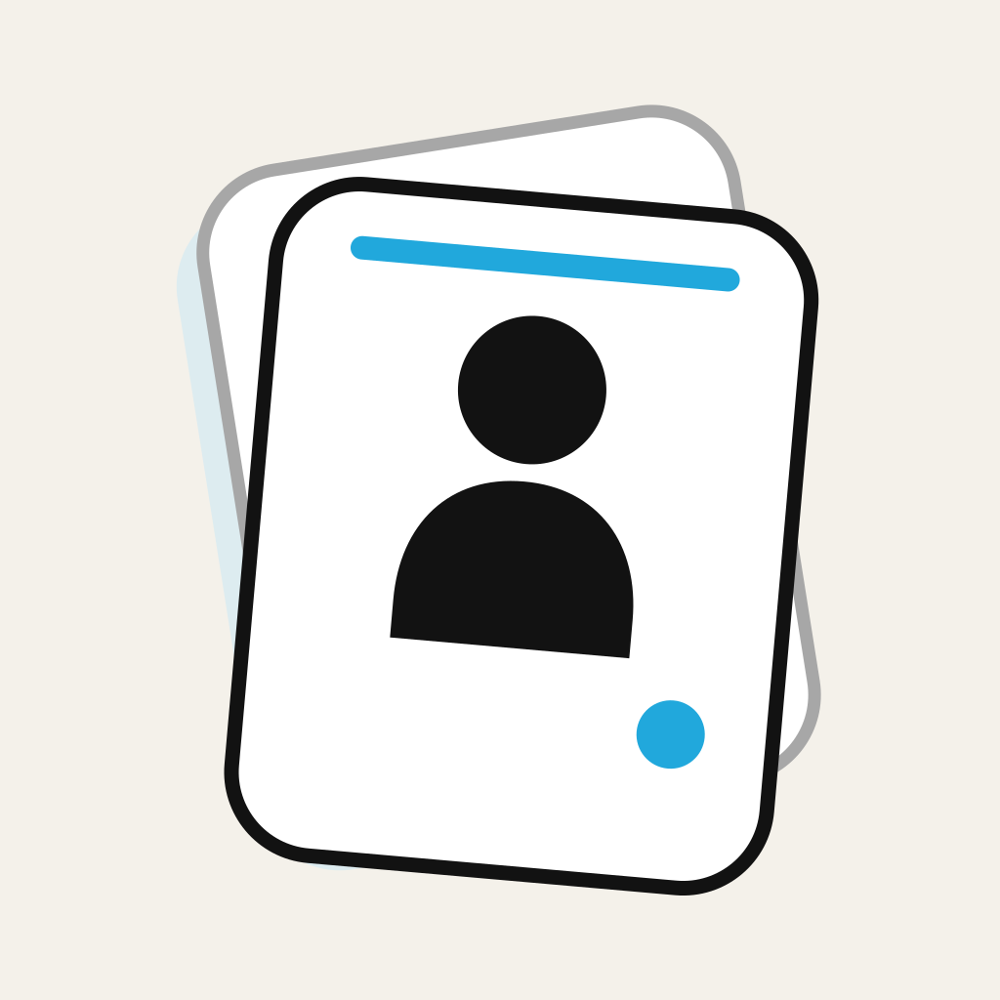
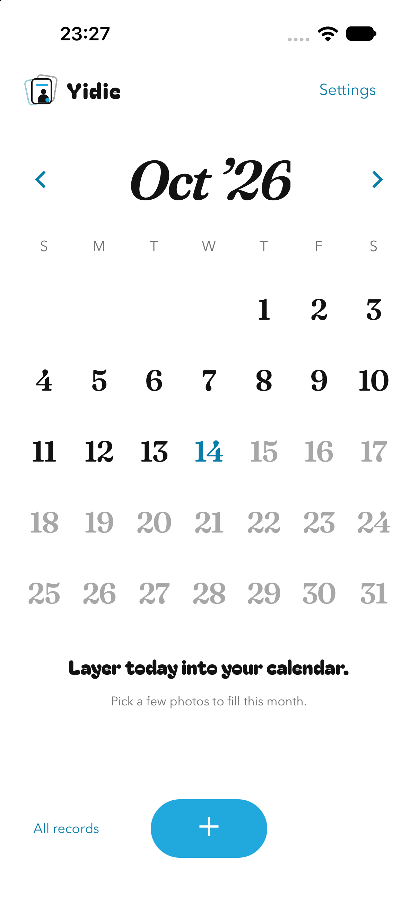

<p align="center">
  
</p>

<h1 align="center">Yidie · 衣叠</h1>

<p align="center">An offline-first outfit diary that turns the days you wore them into a sticker calendar.</p>
<p align="center">把穿过的日子，一张张叠起来。</p>

> **Development build.** Core local flows, editable sticker outlines, verified backup package handling, and image sharing are implemented. Interactive Simulator acceptance for populated screens and real-device Vision quality remain open; this is not a finished or generally installable release. See the live [delivery board](TODO.md).

<p align="center">
  
</p>
<p align="center"><sub>Current app build · empty local library · iPhone 18 Pro Simulator · 2026-10-14</sub></p>

## What makes it different

- **Calendar first.** A worn outfit becomes a sticker on its day. Multiple looks stack, then open into a horizontal photo viewer.
- **Private by design.** Photo selection, date records, foreground cutouts, and sticker styles stay on the device. No account, backend, analytics, cloud inference, or photo upload.
- **A small tool, not a digital closet.** No garment catalog, social feed, recommendations, or shopping layer. Keep a visual record of what you actually wore.
- **Built with native iOS image processing.** Apple Vision creates the transparent cutout; Core Image redraws editable outlines locally.

## Product status

| Area                                                             | Status                                                           |
| ---------------------------------------------------------------- | ---------------------------------------------------------------- |
| Calendar, date browsing, same-day stacks and count badges        | Implemented; simulator scenario review is still due              |
| Batch photo import, date confirmation and local processing queue | Implemented; physical-device edge cases are not fully accepted   |
| Sticker outline preview and editing                              | Implemented locally; verify with an opt-in test photo on device  |
| Backup/restore and native date picker                            | Source and deterministic backup tests pass; picker interaction due |
| Transparent sticker and month image sharing                      | Implemented locally; native share-sheet interaction due          |
| Physical-device Vision quality, accessibility and performance    | Not accepted yet                                                 |
| Public App Store or general device distribution                  | Not available                                                    |

## Run from source

Yidie uses Expo, React Native, TypeScript, SQLite, and a small Swift Expo module for PhotoKit and Vision. It targets iOS only.

Requirements: macOS, a compatible Xcode installation, and Node.js 22 or newer. Expo Go is not sufficient because the app includes a local native module.

```sh
cd apps/mobile
npm ci
npm run check
npm run ios
```

To run the native UI preview with fixed sample data, use `npm run preview:ios`. The preview does not access Photos or the real database. Details are in the [mobile build guide](apps/mobile/README.md).

Installing on a personal iPhone requires building and signing with your own Apple development identity. This repository does not provide a signed public download. A free personal development profile is for testing on your own registered device and expires; broader iOS distribution has separate Apple requirements.

## Privacy and data safety

Yidie copies only photos the user selects. PhotoKit requests disable network access; the app does not fetch iCloud originals on its own. Deleting a Yidie record never deletes the source from Apple Photos. The app's own database and copies are local and excluded from system backup. A `.yidie` backup package contains unencrypted copies of those records and images; choose its destination yourself and keep it private. Until a backup has been created and verified, uninstalling Yidie can remove local records and imported copies. Do not use this development build as the only archive of important photos.

Never attach personal outfit photos, databases, signing files, provisioning profiles, or device identifiers to issues. Use synthetic or explicitly consented test material.

## Project map

```text
apps/mobile/       Expo app, feature UI, local data layer, Swift native module
design/            Brand assets and clearly labeled design prototypes
docs/              Product decisions, architecture, verification and device-safety notes
specs/             Database and native contracts/migrations
scripts/           Reproducible checks and design asset builders
```

Start with [architecture](docs/03-architecture.md), [engineering conventions](docs/10-engineering.md), and the [delivery board](TODO.md). Product scope and the current release gate live in the [PRD](docs/02-prd.md) and [readiness review](docs/16-readiness-review.md).

## Contributing

Bug reports, design feedback, and focused code contributions are welcome. Read [CONTRIBUTING.md](CONTRIBUTING.md) first. Keep date/layout rules in the domain layer, SQL in data repositories, UI in feature modules, and iOS APIs in `modules/yidie-native`. Changes that touch persistence or file ownership need failure-path tests.

The project is licensed under [MIT](LICENSE). The bundled fonts and sample artwork have their own notices; see [asset provenance](design/assets/PROVENANCE.md).

## Project links

- [Live TODO and acceptance gates](TODO.md)
- [Market research and differentiation](docs/01-research.md)
- [Privacy and device testing runbook](docs/15-device-test-safety-runbook.md)
- [Open-source launch notes](docs/17-open-source-launch.md)
